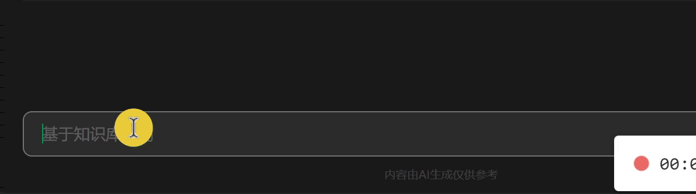
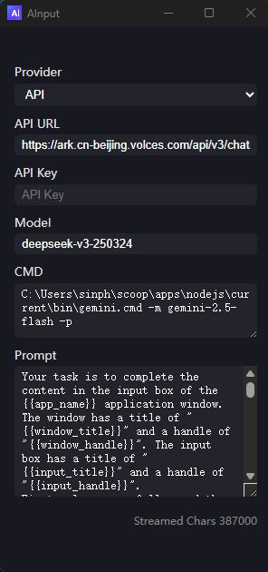

# ainput

[中文文档 | Chinese README](README_zh.md)

---

## What is ainput?

ainput is an AI-assisted, system-wide input helper that shows smart, inline completion hints in any text field on Windows. It integrates with multiple LLM providers or local CLI tools, and uses your input history and clipboard as context to improve suggestions.

---

## Why ainput

- Get real-time AI completions in any input box across apps
- Accurate overlay positioning on multi-monitor/high-DPI setups
- Context-aware suggestions powered by input history and clipboard
- Flexible configuration, privacy focused

---

## Demo

- Smart completion overlay  


- Settings panel  


Full configuration: `src-tauri/config.toml`

---

## How it works

ainput relies on Windows UI Automation (UIA) to detect the focused window and its controls, including editable inputs. The Rust backend (Tauri) gathers context and streams tokens from your configured AI provider to the front-end overlay.

High level flow:
- Use the `windows` crate to call UIA and fetch focused window/control info
- Determine if a control is editable and gather metadata (type, title, rects, etc.)
- Build a context payload from input content, history, and clipboard
- Stream tokens from AI and render/update the overlay window in real-time

---

## Installation

### Option A: Download binary
1. Download the latest `ainput.exe` and `config.toml` from Releases.
2. Place them in the same folder, edit `config.toml` for your AI provider.
3. Double-click `ainput.exe` to run. A tray icon should appear.
4. Modify `config.toml` and restart to apply changes.

### Option B: Build from source

```bash
# Clone repository
git clone https://github.com/alvinfunborn/ainput.git
cd ainput

# Install frontend deps
npm install

# Build Tauri backend
cd src-tauri
cargo build

# Dev mode
cd ..
npm run tauri dev
```

Notes
- Full configuration in `src-tauri/config.toml`
- Supports tray icon, auto-start, and customizable keybindings

---

## AI providers

ainput supports two integration modes:

- API mode
  - Use HTTP API providers (OpenAI-compatible vendors like OpenAI, Volcano Ark, Alibaba Bailian, etc.).
  - Configure `ai_client.api_key`, `ai_client.api_url`, and `ai_client.api_model` in `config.toml`.

- CMD mode
  - Use a local CLI tool (e.g., `gemini-cli`) via command line.
  - Set `ai_client.provider = "CMD"` and `ai_client.cmd` to your executable command.
  - Make sure you have already logged into the tool via terminal if required.

---

## Default keybindings

- When overlay is active
  - Tab: accept completion
  - 1: accept the first character
  - Esc: hide overlay
- You can customize more keys in `config.toml`.

---

## Self-drawn editors (WeChat, DingTalk, etc.)

Some apps use self-drawn editors that don’t fully support UIA text patterns. ainput falls back to a clipboard paste strategy (set clipboard -> send Ctrl+V -> short wait -> restore clipboard). This has a few implications:

- Clipboard is temporarily overwritten (restored shortly after). Clipboard managers/sync tools may interfere.
- Focus must stay on the target input; otherwise paste goes elsewhere or is ignored.
- Global hotkey tools may intercept Ctrl+V.
- Insert location is controlled by the app’s caret; precise selection control is not available.
- Secure inputs or certain rich-text fields may block paste.

Configuration tips
- Add the process name to `ui_automation.self_draw_apps` (Weixin.exe, DingTalk.exe are included by default).
- Optionally add extra control types in `ui_automation.app_edit_control_types` if the app needs it.

---

## Performance

- Memory footprint: ~10MB resident
- CPU: typically <1% idle, even with frequent UI scans
- Fast startup and minimal background threads

---

## Security and privacy

Security
- Open-source, auditable, runs without admin privileges

Privacy
- ainput may upload the current input, window/app metadata, recent input history, and partial clipboard to your AI provider in order to generate completions.
- You can enable basic anonymization via regex; you can also ignore apps in `ignore_apps`.
- Review and accept your provider’s privacy policy before use.
- Do not use ainput in sensitive contexts if you have strong privacy requirements.

---

## Appendix

- Windows Virtual Key Codes: https://docs.microsoft.com/en-us/windows/win32/inputdev/virtual-key-codes
- Windows UI Automation: https://learn.microsoft.com/en-us/windows/win32/winauto/uiauto-controltype-ids
